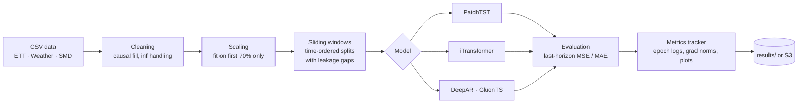

<div align="center">

# Many-to-One Time-Series Forecasting Benchmark

**A reproducible pipeline that benchmarks DeepAR, PatchTST and iTransformer on industrial, meteorological and server-telemetry data, run locally or on AWS SageMaker.**


</div>

---

## Overview

This repository is the experimental pipeline behind the paper **"Comparative Analysis and Implementation of Many-to-One Time-Series Forecasting Models."** It compares three representative forecasting architectures under one protocol:

| Model | Family | Idea |
|---|---|---|
| **DeepAR** (GluonTS) | Probabilistic RNN | Autoregressive recurrent network with a Student-t likelihood |
| **PatchTST** | Transformer, channel-independent | Splits each series into patches, like tokens, to capture local periodic structure |
| **iTransformer** | Transformer, inverted | Treats each variable as a token, so attention models cross-variable dependencies |

Each model reads a multivariate history and forecasts one target variable (*many-to-one*) at four horizons: 96, 192, 336 and 720 steps. Results cover 3 models × 3 datasets × 4 horizons, 36 runs in total, all included in the repository.

The data pipeline, training and evaluation loops, metrics tracking, dataset diagnostics and SageMaker orchestration were written for this project. PatchTST and iTransformer use their unmodified reference implementations, so the comparison tests the protocol, not re-tuned architectures.

## Pipeline



## Results

Test MSE at the final forecast step (z-scored target; lower is better). The best model in each row is in bold.

| Dataset | Horizon | DeepAR | PatchTST | iTransformer |
|---|---|---|---|---|
| **ETT** | 96 | 0.0822 | **0.0215** | 0.0766 |
| | 192 | 0.0589 | 0.0942 | **0.0491** |
| | 336 | 0.1107 | 0.0487 | **0.0460** |
| | 720 | 0.1912 | **0.0743** | 0.1086 |
| **Weather** | 96 | **0.0007** | 0.0152 | **0.0007** |
| | 192 | **0.0001** | 0.0811 | 0.0016 |
| | 336 | **0.0003** | 0.0074 | 0.0031 |
| | 720 | **0.0007** | 0.1048 | 0.0043 |
| **SMD** | 96 | 0.0217 | **0.0216** | 0.0598 |
| | 192 | 0.3505 | **0.0728** | 1.0768 |
| | 336 | 1.0957 | 1.0437 | **0.4642** |
| | 720 | 1.7298 | 2.8988 | **0.3761** |

MAE and inverse-scaled metrics for every run are in [`last-horizon-results/final_results_merged.csv`](last-horizon-results/final_results_merged.csv), and per-run hyperparameters and metadata are in [`last-horizon-results/artifacts_last_horizon/`](last-horizon-results/artifacts_last_horizon/).

### What the results show

The models' strengths are complementary, and they line up with measurable properties of each dataset:

| Dataset | Domain | Seasonality strength | Forecastability¹ | Best model |
|---|---|---|---|---|
| **Weather** | 10-minute meteorology | 0.90 | 0.25 | **DeepAR** wins at every horizon: a smooth, strongly seasonal target suits an autoregressive probabilistic model |
| **ETT** | Hourly electricity transformers | 0.37 | 0.74 | **PatchTST / iTransformer**: patching captures local periodic structure |
| **SMD** | Server telemetry, 38 channels | 0.14 | 0.55 | **iTransformer** at long horizons (4.6× lower MSE than the next best at 720): cross-variable attention copes with irregular, regime-shifting behaviour |

¹ 1 − normalized spectral entropy. Full diagnostics (descriptive statistics, STL trend and seasonality strength, ADF/KPSS stationarity) are in [`last-horizon-results/dataset_metrics_results/`](last-horizon-results/dataset_metrics_results/).

## Engineering highlights

- **Leakage-safe data pipeline.** Scalers are fit on the first 70% of time only; train, validation and test windows are split in time order, with a gap of one forecast horizon between splits so no target leaks into the next split.
- **One protocol for all models.** A shared windowing and evaluation path, plus a `--last_horizon_only` mode so the transformer models are scored exactly the way DeepAR is.
- **Cloud-scale experiments.** `sm_jobs/launch_sm.py` launches the full model × dataset × horizon grid as independent SageMaker training jobs on **EC2 Spot** instances, with S3 checkpointing and stable resume keys, so interrupted jobs resume instead of restarting.
- **Experiment tracking.** A custom `MetricsTracker` writes per-epoch logs, gradient norms, learning-rate schedules, convergence plots and forecast samples for every run.
- **Reproducibility.** Seeds are fixed for `random`, `numpy` and `torch`, DataLoader workers are seeded, and every run records its hyperparameters and metadata.

## Repository layout

```
cli/
  train.py                  # PatchTST / iTransformer training and evaluation
  train_deepar_gluonts.py   # DeepAR via GluonTS
  requirements.txt          # environment for PatchTST / iTransformer
  requirements-deepar.txt   # environment for DeepAR
sm_jobs/
  launch_sm.py              # SageMaker launcher (Spot, S3 checkpoints, resume)
src/
  data/datasets.py          # cleaning, scaling, windowing, leakage-gapped splits (see datasets.md)
  models/                   # model wrappers + reference PatchTST and iTransformer layers
  metrics_tracker.py        # epoch logs, gradient norms, plots
  train_eval.py, utils.py   # shared training loop, seeding
last-horizon-results/       # all 36 runs: metrics, hyperparameters, dataset diagnostics
```

## Quick start

DeepAR's GluonTS dependencies conflict with the transformer stack, so use two environments.

```bash
python3 -m venv .venv && source .venv/bin/activate
pip install -r cli/requirements.txt            # PatchTST / iTransformer
# separate venv for DeepAR:
pip install -r cli/requirements-deepar.txt
```

The pipeline takes any numeric CSV and treats the **last column as the target**. Non-numeric columns such as timestamps are ignored.

```bash
# iTransformer on ETT, 96-step horizon
python cli/train.py --model itransformer --csv_path ./data/ETT.csv \
  --seq_len 336 --pred_len 96 --epochs 10 --batch_size 128 --logdir results

# PatchTST, scored on the final horizon step only (the DeepAR protocol)
python cli/train.py --model patchtst --csv_path ./data/ETT.csv \
  --seq_len 336 --pred_len 336 --last_horizon_only true --logdir results

# DeepAR (GluonTS)
python cli/train_deepar_gluonts.py --csv_path ./data/ETT.csv \
  --seq_len 336 --pred_len 96 --epochs 10 --batch_size 128 \
  --freq h --likelihood student_t --scaling zscore --logdir results
```

Each run writes `hparams.json`, `epoch_log.csv`, `summary.json`, `metrics.json` and diagnostic figures under `results/`.

### Running on AWS SageMaker

```bash
export AWS_REGION=us-west-2
export S3_BUCKET=<your-bucket>            # expects code/, data/, outputs/, checkpoints/
export SAGEMAKER_ROLE_ARN=arn:aws:iam::<account-id>:role/<sagemaker-role>

python sm_jobs/launch_sm.py --model patchtst --dataset ETT.csv \
  --horizons 96 192 336 720 --epochs 30 --instance ml.g4dn.xlarge
```

The role needs S3 read/write on the bucket, `sagemaker:CreateTrainingJob` / `Describe*`, and CloudWatch Logs permissions. Logs stream to CloudWatch, and outputs and checkpoints go to S3.

## References

- **PatchTST**: Nie et al., *A Time Series is Worth 64 Words: Long-term Forecasting with Transformers*, ICLR 2023.
- **iTransformer**: Liu et al., *iTransformer: Inverted Transformers Are Effective for Time Series Forecasting*, ICLR 2024.
- **DeepAR**: Salinas et al., *DeepAR: Probabilistic Forecasting with Autoregressive Recurrent Networks*, International Journal of Forecasting, 2020.

## Author

**Kosta Gjorgjievski**, Tsinghua University (MS, Computer Science) · UCLA (BS, Computer Science) · [GitHub](https://github.com/kostagjorgjievski)
